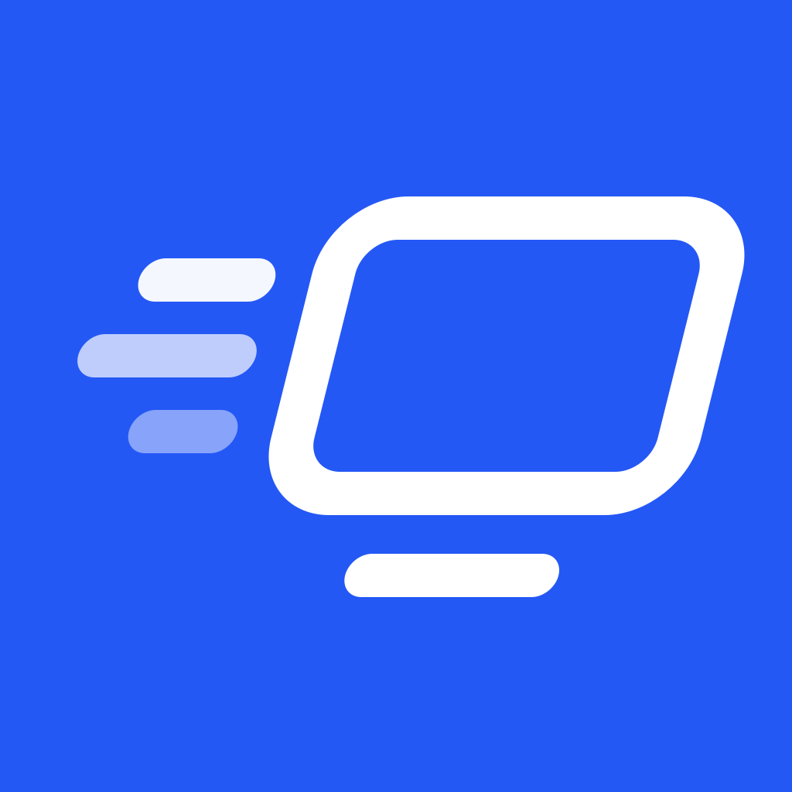
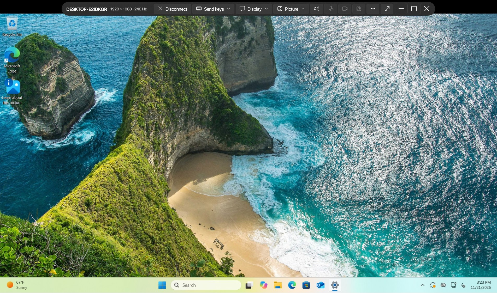
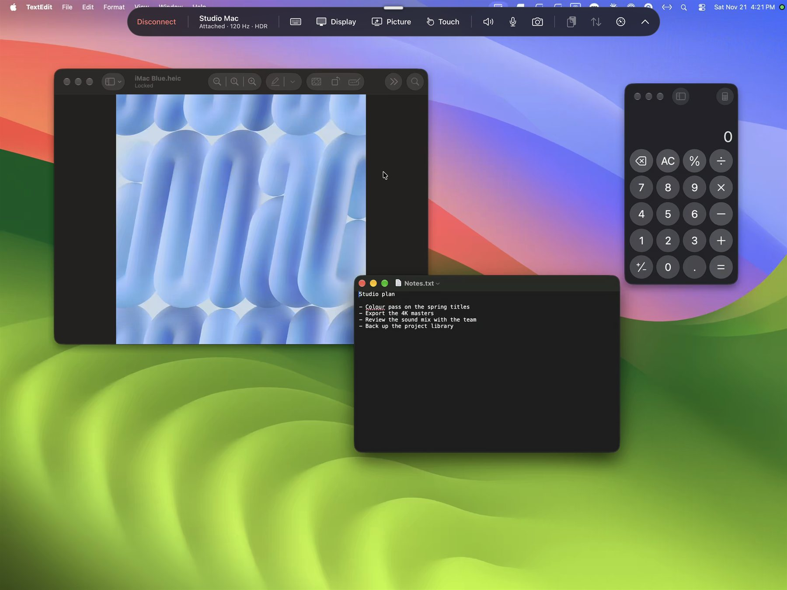
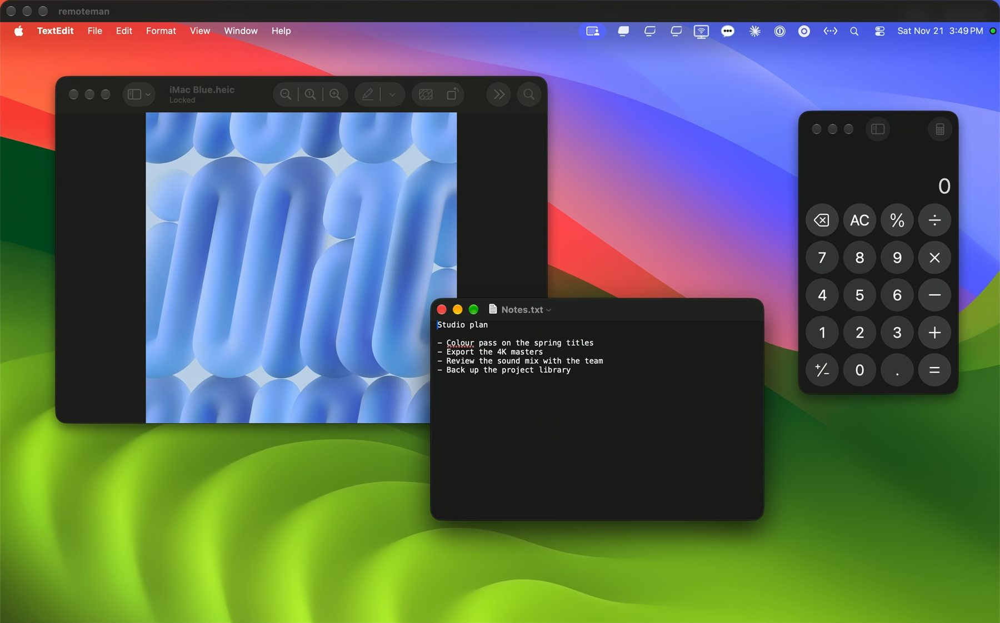
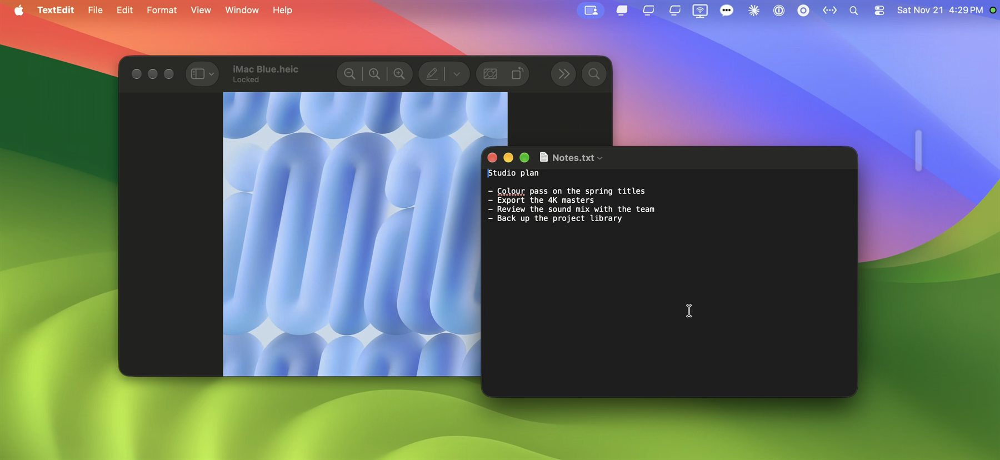

# remoteman

### Your computers, on every screen you own.

remoteman streams your computer's desktop to your other devices at full quality, with its sound, 
your microphone and camera, your pen and your game controller. Straight from device to computer, 
encrypted end to end. No accounts. Nothing in between.

**[Website](https://remoteman.ruxn.com)** · **[Download](https://remoteman.ruxn.com/#download)** · **[Privacy](https://remoteman.ruxn.com/privacy/)** · **[Protocol](docs/PROTOCOL.md)** · **[Discord](https://discord.gg/rN3VARayZV)**

 

A Windows 11 computer's desktop in the remoteman viewer, 1920 × 1080 at 240 Hz.

 

| **AV1 · HEVC · H.264** | **10-bit HDR** | **Up to 240 Hz** | **TLS 1.3 over QUIC** |
|:---:|:---:|:---:|:---:|
| Encoded on the computer's graphics card | When both screens can show it | Follows the screen you watch on | Encrypted end to end, direct |

## Everything a computer does, wherever you are

Not a picture of a screen: the whole computer, with what you hear, say, draw and play.

| | | |
|---|---|---|
| **A picture worth sitting in front of** Encoded on the computer's own graphics card, sharp when nothing moves and smooth when it does. | **A display of its own** Your device becomes another display of the computer, its main one, or its only one. | **Sound, both ways** Hear the computer, and talk through your device's microphone as its own. |
| **Your camera as its webcam** Calls on the computer see you through your phone, tablet or laptop camera. | **Pen, touch and controllers** Draw with pressure, scroll with your fingers, play with the controller in your hands. | **Clipboard and files** Copy on one, paste on the other, and send files across when you switch it on. |

| | |
|:---:|:---:|
|  |  |
| **iPad** · a Mac's desktop at 120 Hz in HDR | **Mac** · another computer in a window of its own |

<b>iPhone</b> · a whole desktop in your pocket. Turn it sideways and it fills the screen.

## How it works

1. **Install the host** on the computer you want to reach.
2. **Install the viewer** on your phone, tablet or other computer, and pair it with the host once.
3. **Connect.** From then on every device you own is a way in, straight to the computer.

## Get it

Free, on everything you use. Downloads are on **[remoteman.ruxn.com](https://remoteman.ruxn.com/#download)**.

| | Host | Viewer |
|---|:---:|:---:|
| **Windows 11**, x64 | ✓ | ✓ |
| **Mac**, Apple silicon | ✓ | ✓ |
| **Linux**, GNOME on x86_64 | ✓ | ✓ |
| **iPhone and iPad** | | ✓ [TestFlight beta](https://testflight.apple.com/join/5wRbTvXB) |

## Private by design

remoteman has no accounts and no servers of ours. Your device pairs with your computer once, and from then on they talk to each other directly, encrypted with TLS 1.3 over QUIC, each side proven by its own key. Nothing about you is collected. [The privacy policy](https://remoteman.ruxn.com/privacy/).

## Under the hood

One Rust core shared by every platform, in apps native to each, and one wire protocol between them. For developers: [the protocol](docs/PROTOCOL.md), [the design notes](docs/PLAN.md) and [how the Windows packages are made](docs/WINDOWS-PACKAGING.md).

## Licence

Copyright (C) 2026 RUXN LLC

remoteman is free software: you can redistribute it and/or modify it under the terms of the GNU General Public License as published by the Free Software Foundation, either version 3 of the License, or (at your option) any later version. It is distributed in the hope that it will be useful, but WITHOUT ANY WARRANTY; without even the implied warranty of MERCHANTABILITY or FITNESS FOR A PARTICULAR PURPOSE. See [LICENSE](LICENSE) for the full text.

Some parts keep their own licences:

- [windows/display-driver](windows/display-driver): MIT, a fork of zako-vdd, with what is left of Microsoft's indirect display sample under the Microsoft Public License ([its README](windows/display-driver/README.md)).
- [vendor/](vendor): the vendored crates keep their own licences (windows-rs and windows-reactor: MIT or Apache-2.0; nv-codec-headers: MIT, in each header), in their folders.
- Releases up to and including 0.1.2 were published under the MIT licence, and they stay under it.

 

 
Made by <b>RUXN LLC</b> · <a href="https://remoteman.ruxn.com">remoteman.ruxn.com</a>

